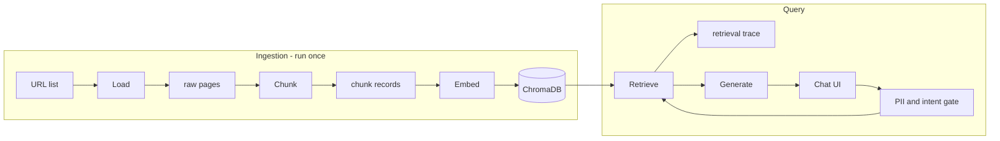
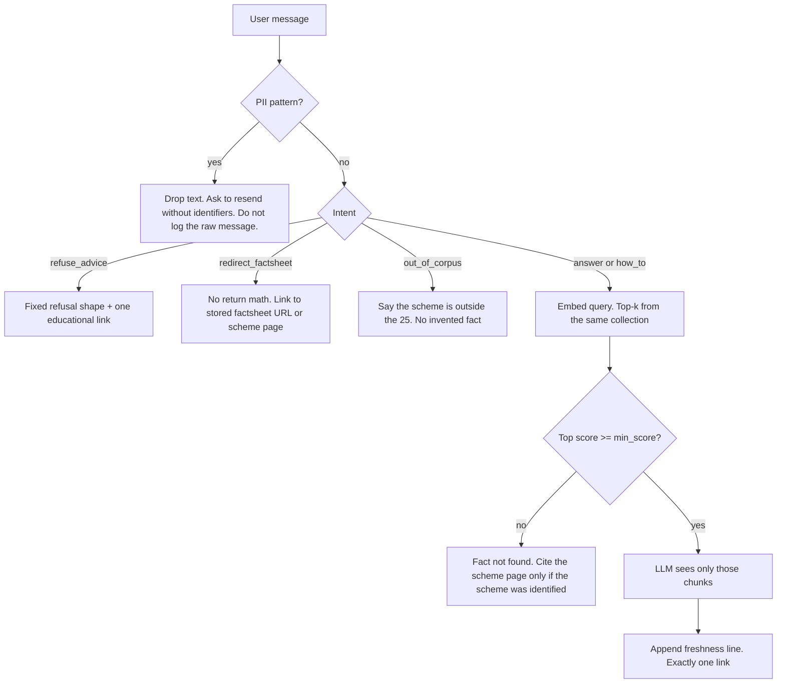

# Architecture: Groww Mutual Fund FAQ Assistant

**Status:** Draft for prototype  
**Source:** [PRD.md](PRD.md)  
**Product:** Facts-only RAG assistant over 25 public HDFC Mutual Fund scheme pages on Groww  
**Not in this design:** investment advice, return math, live NAV, accounts, chat history, or any URL outside the closed corpus

This document is the build contract for the prototype. Each pipeline stage writes a file a reviewer can open. Models, the vector store, and the URL list come from config, not from pipeline code.

## 1. What the system is

A single-user demo with two runtimes:

1. **Ingestion** (operator-run). Load the 25 pages, chunk them by scheme fact, embed them, and persist a Chroma collection plus stage files.
2. **Query** (user-facing). Classify the question, retrieve from that collection, and either generate a cited answer or refuse. The UI is one chat screen.

The model never sees the full corpus. It sees the system prompt plus the chunks retrieval returned for that question.



## 2. Constraints that shape the design

| Constraint | Architectural consequence |
| --- | --- |
| Answers use only the 25 pages (FR-1) | Loader allowlist is the only fetch set. Generation context is retrieved chunks only. Low retrieval score fails closed. |
| Exactly one citation (FR-2) | Retriever picks one URL. Generator is not allowed to invent or add a second link. |
| At most three sentences plus a freshness stamp (FR-3) | Stamp is the last successful load time, stored by the loader and appended after generation. |
| Refuse advice and return comparisons (FR-4, FR-5) | Intent gate runs before generation. Those classes never enter the “answer this fact” prompt. |
| No PII stored (FR-6) | Redact-and-reject runs before logs, traces, the vector store, and the sample Q&A file. |
| Stages are visible (FR-7) | Load, chunk, embed, retrieve, and generate each write an artifact under `data/artifacts/`. |
| Models are config (FR-8) | Embedding model, Chroma path, LLM provider, and model id are read at startup. |

## 3. Components

| Component | Responsibility | Does not |
| --- | --- | --- |
| Config | Load settings and `.env`. Resolve provider, model id, embedding model, Chroma path, `top_k`, minimum score, URL list. | Contain prompts or scraping logic. |
| Loader | HTTP GET each allowlisted URL once per run. Save raw text, final URL, status, fetch time. Record failures. | Follow in-page links. Fill a failed page from elsewhere. |
| Chunker | Split a successful page into fact-sized chunks with scheme name and `source_url` on every record. | Embed or call an LLM. |
| Embedder | Embed chunk text with the configured sentence-transformer. Skip re-embed when collection name already matches model id and corpus version. | Embed the user query (that is the retriever). |
| Vector store | Persistent Chroma collection. Metadata: chunk id, scheme slug, scheme name, fact type, `source_url`, optional factsheet URL found on the page. | Mix vectors from two embedding models in one collection. |
| Intent gate | Label the question before generation: `answer`, `how_to`, `redirect_factsheet`, `refuse_advice`, `out_of_corpus`, `pii`. | Generate the user-facing answer (except the fixed PII resend message). |
| Retriever | Embed the query with the ingestion model. Return top chunks, scores, and one chosen citation URL. Write the trace. | Call the LLM. Answer from memory when the score is below the minimum. |
| Generator | Call the configured LLM with the system prompt and the retrieved chunks only. Return answer text, citation, refusal flag, model id. | Receive the rest of the corpus, compute returns, or store PII. |
| UI | Welcome line, three example questions, standing disclaimer, answer or refusal with one link and the freshness line. | Accounts, history, or a second screen. |

Suggested layout:

```text
config/
  settings.yaml          # embedding model, chroma, provider, top_k, min_score
  urls.yaml              # the 25 Groww URLs and scheme slugs
.env.example             # GROQ_API_KEY, LLM_MODEL_ID, optional other provider keys
src/
  config.py
  pipeline/
    load.py
    chunk.py
    embed.py
    retrieve.py
    generate.py
  guardrails/
    pii.py
    intent.py
  prompts/
    system.txt           # same text for every provider
  ui/
    app.py               # single-screen chat
data/
  artifacts/
    load/                # one JSON per URL + run manifest
    chunks/              # chunk records, pre-embedding
    embed/               # model id, collection name, vector count
    retrieve/            # one trace per query
    generate/            # answer, citation, refusal flag, model id
  chroma/                # persistent Chroma path
```

## 4. Ingestion

Stages run in order. A later stage reads the previous stage’s files. A failed URL is stored on the load manifest and skipped by the chunker. The run still finishes for pages that returned HTTP 200 and usable text.

`Last updated from sources` is the timestamp of the last run in which at least one page loaded successfully. It is written once on the run manifest and read by the UI. It is not “now” at answer time.

### 4.1 Load

For each URL in `config/urls.yaml`:

- Request that URL only. Do not parse or enqueue `href`s.
- Store final URL after redirects, HTTP status, fetch time, and extracted visible text.
- Keep a factsheet URL only when that URL appears in the page text or markup and is saved on the page record. Retrieval may cite it for a returns question (FR-2). It is not fetched.

Artifact: `data/artifacts/load/<run_id>/<slug>.json` plus `manifest.json` (`run_id`, `loaded_at`, successes, failures).

### 4.2 Chunk

Groww scheme pages are fact blocks (expense ratio, exit load, minimum SIP, lock-in, riskometer, benchmark, statement how-to), not long prose. A generic token split can cut a fact in half or glue two schemes together. This prototype uses a **fact-field split**:

1. Detect the scheme name from the page (slug in the URL is the stable id; visible title is stored as the display name).
2. Split on section headings and labeled fields already on the page.
3. Emit one chunk per field, or per tight group when the page presents related lines as one block (for example exit load rows).
4. Prefix every chunk body with the scheme name so “expense ratio of HDFC Large Cap” does not collide with another scheme’s expense ratio.
5. If a page has no detectable fields, fall back to a heading split. Do not merge text from two URLs into one chunk.

Every chunk record:

| Field | Purpose |
| --- | --- |
| `chunk_id` | Stable id, `{slug}:{fact_type}:{index}` |
| `scheme_slug` | One of the 25 slugs |
| `scheme_name` | Display name used in citation wording |
| `fact_type` | `expense_ratio`, `exit_load`, `min_sip`, `lock_in`, `riskometer`, `benchmark`, `statement_howto`, `other` |
| `source_url` | The page URL. This is the citation |
| `factsheet_url` | Optional, only if present on the scraped page |
| `text` | Scheme name + the fact text |

Chunks are written to `data/artifacts/chunks/<run_id>.jsonl` before any embedding, so the demo can show them with the vector index closed.

### 4.3 Embed and store

- Default model: `sentence-transformers/all-MiniLM-L6-v2`. Override only in config. Ingestion and query must read the same key.
- Engine: ChromaDB, persistent directory from config.
- Collection name includes embedding model id and corpus version, for example `hdfc_groww__all-minilm-l6-v2__<run_id>`. A model change creates a new collection. Old vectors are not queried by accident.
- If that collection already exists for the current model id and `run_id`, do not re-embed.
- Metadata on each vector: `chunk_id`, `scheme_slug`, `scheme_name`, `fact_type`, `source_url`, `factsheet_url`.

Artifact: `data/artifacts/embed/<run_id>.json` with model id, collection name, vector count, and the chunk file it indexed.

## 5. Query path

Order is fixed. Generation is the last step, and only for classes that are allowed to answer.



### 5.1 PII gate

Runs first, in process, before any log or trace write. Patterns cover PAN, Aadhaar, account-number-like digit strings, OTP-like codes, email, and phone. On a match:

- Do not write the raw string to logs, Chroma, retrieval traces, or the sample Q&A file.
- Do not echo the identifier.
- Reply with a short request to resend the question without personal details.
- This reply is not a corpus answer and does not pretend to cite a fact.

### 5.2 Intent gate

Rule layer first, so the demo can show why a question was answered or refused (W1). The label is one of:

| Label | When | Next step |
| --- | --- | --- |
| `answer` | A fact the corpus can hold: expense ratio, exit load, minimum SIP, lock-in, riskometer, benchmark, or a named scheme’s other published field | Retrieve, then generate |
| `how_to` | Statement or capital-gains download steps | Retrieve, then generate. Steps must come from chunk text |
| `redirect_factsheet` | Returns, CAGR, alpha, ranking, “which fund did better”, “beating the benchmark” | Do not generate a number. One link: stored factsheet URL if the page had one, otherwise the scheme page |
| `refuse_advice` | Buy, sell, hold, “which should I pick”, portfolio construction | Fixed refusal copy. One educational link. No preferred scheme |
| `out_of_corpus` | A scheme or AMC that is not one of the 25 | Say it is outside the covered schemes. Do not answer from model knowledge |
| `pii` | Handled above | Stop |

Scheme identity is a match against the 25 slugs and their display names. “HDFC Large Cap” maps to the large-cap URL. A second AMC, or an HDFC scheme not in the list, is `out_of_corpus`.

If the question names a covered scheme and also asks for a judgment (“Should I buy HDFC Small Cap?”), the label is `refuse_advice`, not `answer`. The educational link may be that scheme’s page. The text must not recommend it.

Decision rule from the PRD: answer the exact fact asked. Do not substitute a neighboring fact.

### 5.3 Retrieval

- Embed the query with the same `sentence-transformers` model id used at ingestion.
- Query the collection recorded in the latest embed artifact.
- `top_k` and `min_score` come from `settings.yaml`.
- Prefer chunks whose `scheme_slug` matches the scheme the intent gate identified. If the question names no scheme (for example a general “how do I download a capital-gains statement?”), use the global top hit.
- Chosen citation is `source_url` of the winning chunk. For `redirect_factsheet`, use `factsheet_url` when it is non-empty, otherwise `source_url`.
- If the best score is below `min_score`, do not call the generator for a fact. Response: the fact was not found on the official page. Cite the scheme page only when the scheme was identified. Otherwise treat the question as outside the corpus.

Artifact: `data/artifacts/retrieve/<query_id>.json` with the redacted query, chunk ids, scores, and `citation_url`.

### 5.4 Generation

- Provider default: Groq. API key and model id from `.env` only. The problem statement’s example id `qwen/qwen3.8-27b` is a value in `.env`, not a constant in code.
- Config may select Gemini, OpenAI, Anthropic, or Mistral. The prompt file does not change when the provider changes. A small provider adapter maps the same messages to each SDK.
- System prompt states: facts only; at most three sentences; exactly one citation from the supplied URLs; refuse advice; no return math; no PII; use only the retrieved chunks; if the chunks do not contain the fact, say it was not found.
- User message to the model contains the classified intent, the scheme name, and the chunk texts with their URLs. It does not contain other pages.
- After the model returns, the app checks: sentence count, single URL, URL is one of the retrieved URLs (or the stored factsheet URL for a redirect), and the refusal flag matches the intent. If the check fails, replace the body with the deterministic not-found or refusal template rather than showing a non-compliant answer.
- Append `Last updated from sources: <ISO date from the load manifest>`.

Artifact: `data/artifacts/generate/<query_id>.json` with answer text, citation URL, refusal flag, and model id. Queries that were dropped for PII are not written here with their original text.

## 6. UI

One screen. The visual source of truth is the Stitch export, not a separate mock:

- `stitch_hdfc_mutual_fund_factsheet_assistant.zip`
- `design/stitch/stitch_hdfc_mutual_fund_factsheet_assistant/calm_fintech_assistant/DESIGN.md`
- `design/stitch/stitch_hdfc_mutual_fund_factsheet_assistant/hdfc_scheme_facts_desktop/code.html`

`src/ui/app.py` implements the facts column from that desktop screen. Colors are the Groww site tokens in `DESIGN.md`: page `#FFFFFF`, card `#F8F8F8`, border `#E9E9EB`, text `#44475B`, secondary `#7C7E8C`, faint `#A1A3AD`, green `#04B488`, notice wash `#E9FAF3`. Type is Inter. The Groww site header in the Stitch file (Screener, Compare, search, account) is not part of this prototype.

| Element | Source |
| --- | --- |
| Notice | Exact string: `Facts-only. No investment advice.` Always visible, with `25 HDFC DIRECT SCHEMES` |
| Welcome line | Static. Names facts about the covered HDFC schemes |
| Suggested queries | Three buttons: expense ratio of HDFC Large Cap, exit load of HDFC Mid Cap, minimum SIP of HDFC Small Cap |
| User question | Right-aligned chip on `#F8F8F8` |
| Answer card | Fact text, then a **Source link** heading and one link `[Scheme name — Groww](url)`, then `Last updated from sources: <date>` |
| Composer | Placeholder `Ask a published fact`. Green send control |

A cited fact uses the card title “Published Fact Verification.” A refusal, a missing fact, or an out-of-corpus reply uses “Facts-only reply” and still shows one source link. A question that contains personal data is plain text, with no link and no freshness line.

No login, no transcript stored on the server beyond the stage artifacts for the demo. Artifact queries are redacted by the PII gate before write.

## 7. Configuration

| Setting | Default | Read from |
| --- | --- | --- |
| Embedding model | `sentence-transformers/all-MiniLM-L6-v2` | `config/settings.yaml` |
| Vector DB | ChromaDB, path `data/chroma` | `config/settings.yaml` |
| LLM provider | `groq` | `config/settings.yaml` |
| LLM model id | example `qwen/qwen3.8-27b` | `.env` `LLM_MODEL_ID` |
| Provider API keys | none committed | `.env` |
| Corpus | 25 URLs | `config/urls.yaml` |
| `top_k`, `min_score` | set for fail-closed retrieval | `config/settings.yaml` |

Changing `LLM_MODEL_ID` affects the next request with no code edit. Changing the embedding model id changes the collection name; the operator re-runs embed. `.env` is gitignored. README and sample Q&A contain no keys.

## 8. Guardrails

- **Public pages only.** The HTTP client’s allowlist is `config/urls.yaml`. Factsheet URLs are stored as citation targets, not crawled.
- **No performance language.** The `redirect_factsheet` path does not call the model with a prompt that asks it to compare. The template says the figures are on the linked page.
- **Citation wording.** The fact is stated first. The next block is the heading `Source link` and one link, `[Scheme name — Groww](url)`. The link is the chunk’s `source_url`.
- **Fail closed.** Missing page, low score, or empty field becomes “not found on the official page,” not a number from model weights.
- **Refusal tone.** “I can only share published facts such as expense ratio, exit load, and lock-in. I can’t suggest whether to buy or sell.” The scheme link is the next line, under `Source link`.

## 9. What a reviewer can open

After one ingestion run and one query:

| Stage | File | Shows |
| --- | --- | --- |
| Load | `data/artifacts/load/<run_id>/manifest.json` | URL, status, fetch time, failures |
| Chunk | `data/artifacts/chunks/<run_id>.jsonl` | Chunk id, scheme, fact type, source URL, text |
| Embed | `data/artifacts/embed/<run_id>.json` | Model id, collection, count |
| Retrieve | `data/artifacts/retrieve/<query_id>.json` | Scores and the citation URL that supported the answer |
| Generate | `data/artifacts/generate/<query_id>.json` | Answer, citation, refusal flag, model id |

Acceptance items in PRD section 12 map onto this path: in-corpus facts hit retrieve + generate; buy/sell hits `refuse_advice`; return comparisons hit `redirect_factsheet`; unknown schemes hit `out_of_corpus`; PII never reaches those files.

## 10. Known limits

These belong in the README as well as here.

- The corpus is the 25 HDFC direct-growth Groww pages at last successful load. The stamp is that load date.
- A Groww markup change can fail extraction. Failures stay on the load manifest.
- This is not a SEBI-registered adviser and does not replace the scheme information document or factsheet.
- Statement download is described from page text. The assistant has no account access.
- Retrieval quality depends on `all-MiniLM-L6-v2` and the fact-field chunks. Below `min_score`, the answer is not found.
- Groq and the optional Gemini, OpenAI, Anthropic, and Mistral paths need the operator’s own keys and quotas.

## 11. Build order

Same sequence as the PRD, so each phase is demoable on its own:

1. `settings.yaml`, `urls.yaml`, `.env.example`.
2. Loader and load artifacts.
3. Fact-field chunker and chunk file.
4. Embed into a persistent, versioned Chroma collection.
5. Retriever and retrieval trace.
6. Intent gate, PII gate, and generator with the provider adapter.
7. Single-screen UI.
8. Source list, sample Q&A (5–10, including one refusal and one not-found), README.
